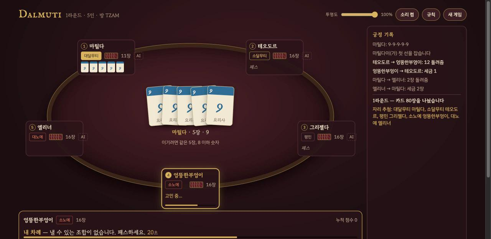

# 달무티 온라인 — 무료 웹 카드게임 (Dalmuti)

설치 없이 브라우저에서 바로 하는 **달무티 카드게임**입니다. 혼자 AI와 하거나, 방 코드를 공유해 친구와 4~8명이 같이 할 수 있습니다.

**▶ 바로 플레이: https://dalmuti-game-6euz.onrender.com/**



## 특징

- **혼자 하기**: 빈 자리는 AI가 채웁니다. `index.html`만 열어도 동작합니다
- **같이 하기**: 방을 만들고 4글자 코드나 초대 링크로 참가합니다. 공개 방은 로비 목록에 보입니다
- **끊겨도 이어서**: 새로고침이나 재접속을 하면 같은 자리로 돌아옵니다. 자리를 비운 동안에는 AI가 대신 둡니다
- **차례 제한시간 30초** (멀티), 효과음, 단축키(Enter 내기 · P 패스 · Esc 숨기기)
- 빌드 도구 없이 Vanilla JS. 서버 의존성은 `ws` 하나뿐입니다

## 게임 규칙 요약

- 카드 80장: 숫자 n이 n장(1~12) + 광대 2장. **숫자가 작을수록 강합니다**
- 선이 같은 숫자를 원하는 장수만큼 내면, 다음 사람은 **같은 장수 + 더 작은 숫자**를 내거나 패스합니다
- 먼저 손을 턴 순서대로 다음 라운드 신분(대달무티 ~ 대노예)이 정해집니다
- 세금: 노예가 가장 좋은 카드를 바치고, 달무티는 아무 카드나 돌려줍니다
- 혁명: 광대 2장을 받은 사람이 선언하면 세금이 없어집니다. 대노예가 선언하면 신분이 뒤집힙니다

## 로컬 실행

```bash
npm install
npm start          # http://localhost:3000 (PORT 환경변수로 변경)
```

같은 네트워크의 친구는 터미널에 찍힌 `http://<내 IP>:3000`으로 접속합니다.

## 구조

| 파일 | 역할 |
| :--- | :--- |
| `engine.js` | 게임 엔진(룰·AI·상태). 브라우저와 Node가 같이 씁니다 |
| `server.js` | 멀티플레이 서버. 엔진을 돌리고, 접속자마다 자기 손패만 보이게 필터링해 보냅니다 |
| `index.html` | 화면, 입력, 싱글/멀티 연결 |

자세한 설계는 [CLAUDE.md](CLAUDE.md)에 있습니다.
